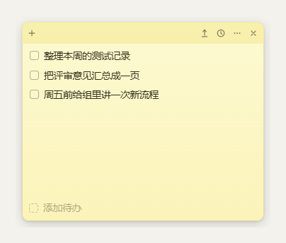

# 简单待办

一个只想把事记下来的桌面便签。黄底、圆角、无边框，勾掉就收进历史；没有账号、没有云同步、全程不联网。



## 用法

| 操作 | 说明 |
| --- | --- |
| 拖动顶栏 | 把便签放到屏幕任意位置，位置和大小自动记住 |
| 拖动窗口最外缘 | 调整大小（最小 240 × 200） |
| 点「＋ 添加待办」 | 新建一条，回车保存，Esc 取消 |
| 双击文字 | 改内容，回车保存 |
| 点左侧方框 | 标记完成，整条收进历史，5 秒内可撤销 |
| 鼠标划过某行 | 右侧出现 `×`，删除 |
| 拖动某行 | 调整顺序 |
| 时钟图标 | 打开历史：按天分组，可还原、可单条删除、可清空 |
| 上箭头图标 | 置顶显示 / 取消置顶 |
| × | 收进托盘（不是退出），不占用任务栏和 Alt+Tab |
| `Ctrl + N` / `Ctrl + H` | 新建 / 打开历史 |
| `Ctrl + Alt + T` | 随时唤出或收起 |
| 托盘图标右键 | 显示隐藏、置顶、开机自启、打开数据文件夹、退出 |

> Windows 11 默认把新出现的托盘图标收进「^」溢出区。想让它常驻时钟旁边：把图标从溢出区拖到任务栏，或到 设置 → 个性化 → 任务栏 → 其他系统托盘图标 里打开「简单待办」。

## 数据

- 位置：`%APPDATA%\SimpleTodo\data.json`
- 纯本地 JSON，随时可以备份或手改；卸载程序不会删除它。

## 目录结构

```
todolist/
├─ src/                应用本体（Electron，无框架、无打包器）
│  ├─ main.js          窗口、托盘、全局热键、data.json 读写
│  ├─ preload.js       contextBridge 暴露给界面的接口
│  └─ renderer/        index.html + styles.css + renderer.js
├─ assets/             运行时图标（窗口图标、托盘图标）
├─ build/              打包用图标（electron-builder 读取，不参与运行）
├─ tools/
│  └─ make-icons.py    纯 Python 画图标，无第三方依赖
├─ docs/               界面截图（README 用）
├─ dist/               安装包产物（已被 .gitignore 忽略）
├─ package.json        依赖、脚本、electron-builder 配置
└─ README.md
```

## 开发

```bash
npm install
npm start           # 直接运行（开发时用）
npm run icons       # 重新生成图标
npm run preview     # 浏览器里看界面（需装 Python，端口 8777，数据存 localStorage，不碰真实数据）
npm run dist        # 打包安装程序到 dist/
```

国内网络下载 Electron 慢，可以加镜像：

```powershell
$env:ELECTRON_MIRROR="https://npmmirror.com/mirrors/electron/"
$env:ELECTRON_BUILDER_BINARIES_MIRROR="https://npmmirror.com/mirrors/electron-builder-binaries/"
npm run dist
```

打包产物：`dist/简单待办-1.0.1.exe`，按用户安装（不需要管理员权限），可直接发给别人。

## 常见改动

| 想改什么 | 改哪里 |
| --- | --- |
| 字号、行距 | `src/renderer/styles.css` 里 `body` 的 `font-size` / `line-height` |
| 便签颜色 | `styles.css` 里 `.shell` 的渐变、`.bar` 的底色 |
| 首次启动占屏比例、默认位置 | `src/main.js` 的 `defaultBounds()`（当前 16.7% 宽 × 29% 高，右上角留 16px） |
| 全局热键 | `src/main.js` 里的 `CommandOrControl+Alt+T` |
| 需要显示在任务栏 | `src/main.js` 把 `skipTaskbar: true` 改成 `false` |

## 关于「未知发布者」

安装包没有做代码签名，别人在自己电脑上首次运行时 Windows 会提示「未知发布者」，点「更多信息 → 仍要运行」即可。
